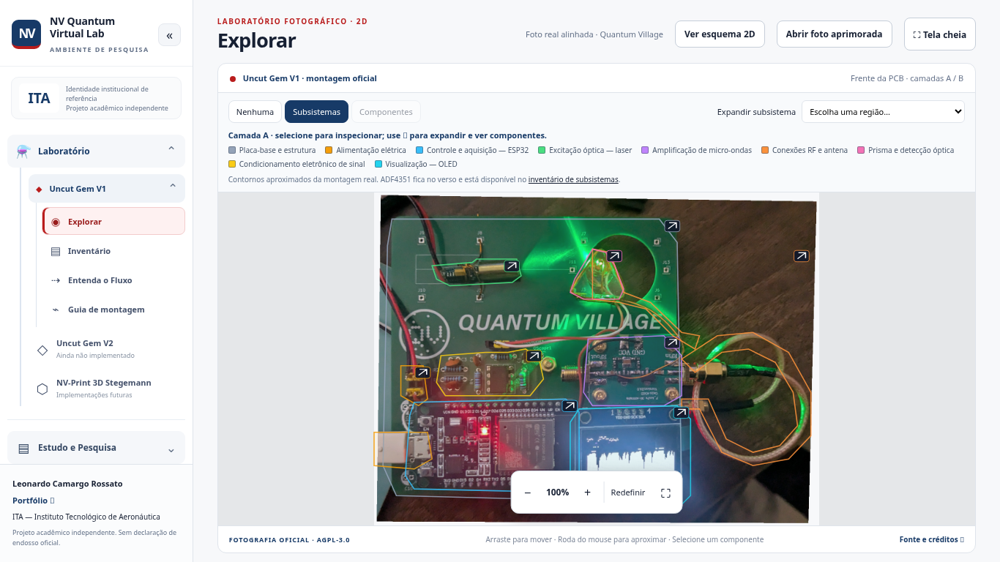
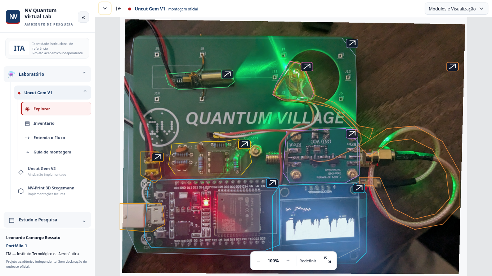

# Scientific Viewer — interface adaptativa

## Implementação e estados

`ViewerToolbar.tsx` pertence ao workspace inteiro, acima do inspetor e da fotografia. A barra compacta tem 48 px; controles de camada são um painel sobreposto, sem consumir altura. Minimizar libera os 48 px e mantém uma aba vermelha com detalhe amarelo. Camada, subsistema, seleção, zoom e pan permanecem no Workbench, separados dos estados de menu, expansão e minimização.

O menu permite teclado, Escape, clique externo, esquema 2D e fullscreen. Prisma 3D permanece desabilitado como “Em breve”. Créditos e AGPL-3.0 ficam em um diálogo acessível. O título grande, botão de foto aprimorada e rodapé fotográfico foram removidos; os arquivos de imagem permanecem preservados.

`InspectorResizeHandle.tsx` usa captura do ponteiro, área de 10 px e role separator com valores acessíveis. Setas ajustam 10 px, Home e duplo clique restauram 315 px; End aplica o máximo. O máximo é aproximadamente 45% do workspace, preservando espaço da foto. Expandir painel usa temporariamente o máximo e não apaga a preferência. Em tablet/mobile o inspetor continua como drawer, sem exigir divisória.

Persistência: `nv-explore-inspector-width`, `nv-explore-toolbar-minimized` e indicador de descoberta inicial. Valores inválidos usam padrão. Nenhum item selecionado ou dado privado é persistido. A indicação inicial termina em 1,2 s e respeita movimento reduzido.

No redimensionamento, a fotografia mantém zoom e escala os deslocamentos proporcionalmente ao novo ajuste da imagem, preservando o ponto central. Somente entrar num subsistema calcula um novo foco; abrir/fechar painéis não reinicia zoom. Fullscreen agora contém todo o workspace para preservar os controles e inspetor.

## Métricas antes/depois

Capturas e medições locais no Chromium, navegador novo por resolução, navegação lateral padrão. Antes: commit `8a1448e`; depois: implementação deste relatório. Valores em pixels CSS. Em tablet/mobile, o drawer sobrepõe a foto e não reduz sua largura. “Cabeçalho/controles antes” é a faixa entre o cabeçalho antigo e o viewport; depois é a barra compacta, sem painel suspenso aberto.

| Resolução | Altura foto antes → depois | Largura sem inspetor | Largura com inspetor | Cabeçalho/controles | Altura com barra minimizada |
|---|---:|---:|---:|---:|---:|
| 1366 × 768 | 455 → 720 | 1034 → 1102 | 716 → 777 | 241 → 48 | 768 |
| 1920 × 1080 | 783 → 1032 | 1582 → 1656 | 1267 → 1331 | 225 → 48 | 1080 |
| 768 × 1024 | 752 → 912 | 742 → 768 | 742 → 768 | 179 → 48 | 960 |
| 390 × 844 | 465 → 732 | 364 → 390 | 364 → 390 | 286 → 48 | 780 |

Em 1366 × 768: ganho de **265 px (58.2%) na altura útil**. Expandir controles sobrepostos não altera essa altura; minimizar acrescenta mais 48 px. Trata-se de aproveitamento da área de visualização, sem alteração na resolução ou nos dados científicos da foto.

### Capturas 1366 × 768

Antes:

Depois:

Outras resoluções e métricas brutas: [evidências](../code/tests/evidence/scientific-viewer/). Para repetir: `METRICS_PHASE=After node code/scripts/ViewerMetrics.mjs`.

## Arquivos e responsabilidades

- `code/src/ViewerToolbar.tsx`: estados, menu, créditos, foco e descoberta.
- `code/src/InspectorResizeHandle.tsx`, `InspectorLayout.ts`, `InspectorLayout.test.ts`: ajuste, validação e limites.
- `code/src/Workbench.tsx`, `Workbench.css`: composição, fullscreen, grid e preservação do foco da imagem.
- `code/scripts/BrowserAdaptiveViewerSmoke.mjs`, `ViewerMetrics.mjs`: aceites e medição.
- `BrowserSmoke.mjs`: executa também o teste adaptativo no workflow de interface existente.
- `BrowserPhotoLayersSmoke.mjs`, `BrowserSchemeSmoke.mjs`, `BrowserImageViewerSmoke.mjs`: acionadores atualizados para a barra e preservação das regressões.
- Este relatório, capturas e ADR-0013. Nenhum arquivo científico, PNG da aplicação ou workflow de deploy foi alterado.

## Validação e auditoria

`npm ci` executado com cache local em `/tmp/nv-npm-cache` após o cache padrão do ambiente falhar; dependências e lockfile preservados. Testes TypeScript/Python, build, nomenclatura e cinco suítes Chromium verificam toolbar, menus, acessibilidade, resize, persistência, inválidos, fullscreen nativo/fallback, zoom/pan, camadas e demais páginas.

O workflow `LCR_INTERFACE_SMOKE.yml` existente chama BrowserSmoke, que passa a incluir o teste adaptativo, sem modificação de infraestrutura. Status dos workflows no commit entregue deve ser consultado nos links da entrega; não confundir testes locais com aprovação independente do Quality & Security Auditor.

**Pendência:** reteste independente e aprovação final humana. A opção 3D é somente uma indicação futura, não uma funcionalidade implementada.

## Ajuste de abertura e zoom

Os menus lateral e superior iniciam abertos em cada carregamento, mesmo quando uma visita anterior deixou a preferência minimizada. Ambos podem ser recolhidos manualmente. Os controles menos, percentual, mais, Redefinir e fullscreen passaram para a barra superior, ao lado de Módulos e Visualização; não há barra de zoom sobreposta à fotografia. Em telas pequenas, a barra usa duas linhas para manter controles legíveis e evitar overflow. Esta regra substitui a restauração automática do modo minimizado descrita acima; a largura do inspetor continua persistida.

## Complemento Builder 2 — camadas persistentes e retorno (09/11/2026)

Modos Subsistemas, Componentes e Nenhuma ficam visíveis ao lado de Módulos e Visualização. A seta acoplada aos modos abre um painel próprio sobreposto de subsistemas, legenda e componentes não mapeados. O botão Voltar à placa inteira é um controle flutuante sobre a fotografia e não depende do menu. Redefinir na toolbar modifica somente zoom/pan, preservando o contexto de subsistema.

Correção incremental da composição aprovada em ADR-0013, sem biblioteca adicional, alteração do mecanismo de imagem ou nova decisão arquitetural. Testes Playwright foram ampliados; a aprovação independente do Auditor Geral permanece um gate posterior.
